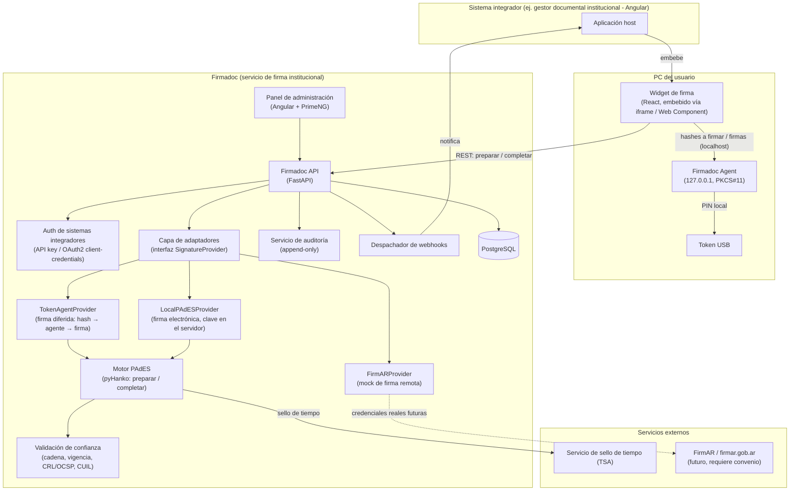
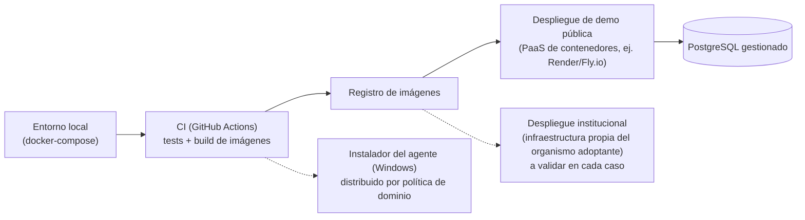
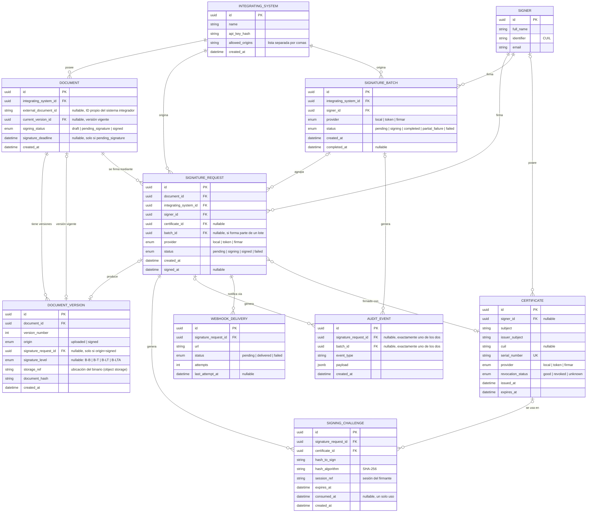

# Firmadoc

## Índice

0. [Ficha del proyecto](#0-ficha-del-proyecto)
1. [Descripción general del producto](#1-descripción-general-del-producto)
2. [Arquitectura del sistema](#2-arquitectura-del-sistema)
3. [Modelo de datos](#3-modelo-de-datos)
4. [Especificación de la API](#4-especificación-de-la-api)
5. [Historias de usuario](#5-historias-de-usuario)
6. [Tickets de trabajo](#6-tickets-de-trabajo)
7. [Pull requests](#7-pull-requests)

---

## 0. Ficha del proyecto

### **0.1. Tu nombre completo:**
Ivan Alejandro Sambrana

### **0.2. Nombre del proyecto:**
Firmadoc

### **0.3. Descripción breve del proyecto:**
Firmadoc es un **servicio de firma digital institucional**: un único componente, mantenido por el área de sistemas de un organismo público, que cualquier aplicación del organismo consume para firmar documentos PDF sin salir de su propia interfaz (mediante un widget embebible y una API). Elimina el flujo manual actual de "descargar el documento → firmarlo afuera con el token → volver a subirlo al sistema". Su modo principal es la **firma con el token criptográfico que los funcionarios ya tienen**, con certificado de una Autoridad Certificante licenciada (firma digital con presunción legal, Ley 25.506), mediante un agente local y **firma diferida**: el servidor prepara el PDF y calcula el hash, el token firma solo ese hash y el servidor incrusta la firma, de modo que el documento nunca viaja a la PC del usuario y la clave privada nunca toca el servidor. Además ofrece firma remota (ej. FirmAR/SIU) y un motor propio de firma electrónica para demostraciones, detrás de la misma interfaz.

### **0.4. URL del proyecto:**
_Pendiente — se completará cuando exista un despliegue (Entrega 3)._

### 0.5. URL o archivo comprimido del repositorio
https://github.com/sambranaivan/AI4Devs-finalproject (fork de `LIDR-academy/AI4Devs-finalproject`, rama `feature/entrega-1-IAS`)

---

## 1. Descripción general del producto

### **1.1. Objetivo:**

Que un organismo público tenga **un solo servicio de firma digital**, reutilizable por todos sus sistemas, en lugar de que cada aplicación implemente (o contrate) su propio firmador. Hoy, en muchos organismos, los funcionarios ya tienen un token con certificado de una AC licenciada, pero el sistema documental no tiene forma de invocar la firma: el usuario descarga el documento, lo firma por fuera y lo vuelve a subir. Esto es lento, propenso a errores y deja la validación de la firma (cadena de confianza, vigencia, revocación) librada a cada sistema.

Firmadoc resuelve esto con un **widget embebible** (diseñado para integrarse también en sistemas Angular, un framework frecuente en organismos públicos; la integración con una página Angular de prueba es un criterio de aceptación del Ticket 2) y un **backend con proveedores de firma intercambiables**: la firma con el token USB del usuario (a través de un agente local, porque un navegador o un servidor no pueden acceder al token), la delegación en servicios de firma remota y un motor propio de firma electrónica para pruebas y demostraciones.

**A quién aporta valor:**
- **Usuarios finales (funcionarios)**: firman sin salir del sistema que ya usan, con su token, ingresando el PIN una sola vez aun para un lote de documentos.
- **Equipos de desarrollo de los sistemas del organismo**: integran firma digital sin construir un firmador propio ni gestionar drivers, tokens ni validación de certificados.
- **Área de sistemas y auditoría**: concentran en un solo lugar la validación de las firmas, la política de confianza y la trazabilidad de quién firmó qué, cuándo y con qué certificado.

### **1.2. Características y funcionalidades principales:**

- **Firma digital con token mediante agente local (modo principal, `token`)**: una aplicación liviana instalada en la PC del usuario (Firmadoc Agent) accede al token por PKCS#11, muestra un diálogo de confirmación con el nombre del documento, pide el PIN localmente y firma únicamente los hashes que recibe. El PIN y la clave privada nunca salen del token ni de esa PC.
- **Firma diferida**: el servidor prepara el PDF (reserva el espacio de la firma, calcula el hash de los atributos firmados) y, cuando el token devuelve la firma, la incrusta. El PDF no viaja a la PC; la clave privada no toca el servidor.
- **Validación en el servidor**: antes y después de firmar se verifica la cadena de confianza hasta la AC Raíz, la vigencia, la revocación (CRL/OCSP), que el CUIL del certificado coincida con el del usuario y que el hash devuelto corresponda a un desafío vigente de esa sesión.
- **PAdES con sello de tiempo y revocación embebida (nivel B-LT)**: para que la firma siga siendo verificable a largo plazo (requiere un servicio de sellado de tiempo; ver 2.7).
- **Firmas múltiples sobre un mismo documento**: cada firma nueva se agrega como actualización incremental del PDF, sin invalidar las anteriores.
- **Widget de firma embebible**: se integra vía `<iframe>` (mecanismo principal, sin acoplarse al framework del sistema host) o vía Web Component, en cualquier sistema cliente.
- **Motor de firma propio (`local`)**: firma el PDF con certificados propios (autofirmados o de una CA de demostración) usando `pyHanko`. Produce firma electrónica (no firma digital con presunción legal) y permite demostrar y evaluar todos los flujos sin token físico.
- **Adaptador de servicio de firma remota (`firmar`, simulado)**: replica el contrato de integración de FirmAR/SIU (OAuth + envío de documento + callback con OTP/PIN en el servicio remoto), para usuarios que firman con certificado remoto y no con token USB.
- **Arquitectura de proveedores intercambiable**: agregar un nuevo proveedor de firma no requiere tocar el resto del sistema (patrón adapter/strategy).
- **Carga de PDF desde el navegador**: en general la firma **parte de cargar un PDF** en la sección «Firmar documento» del panel (uno o varios; con varios se firman en lote). El PDF queda guardado como versión original (v1) y se firma con el widget embebido en esa misma página.
- **Vinculación de documentos existentes (camino por sistema integrador)**: el sistema integrador envía el PDF (o referencia un documento que Firmadoc ya conoce, por su ID) y recibe una `signing_url` embebible; sigue existiendo junto a la carga desde el navegador.
- **Descarga y versionado del resultado**: al completar la firma, el documento firmado queda **siempre** disponible para descarga directa, con el nombre original del archivo (`download_url` / base64) **y, al mismo tiempo**, registrado como una **nueva versión** del documento original — sin sobrescribir la versión anterior, pero marcada como la vigente, para seguir operando sobre ese documento. No son dos caminos alternativos: ambas cosas ocurren en toda firma completada.
- **Estados del documento y fecha límite**: cada documento recorre `borrador → pendiente de firma (con fecha límite opcional) → firmado`, de modo que el sistema integrador puede mostrar y filtrar qué está pendiente de firma.
- **Listado de firmantes por documento**: quién firmó, cuándo y con qué certificado, consultable desde la API y el panel.
- **Notificación por webhook**: el sistema integrador recibe un aviso automático cuando el documento queda firmado.
- **Panel de administración y auditoría**: listado de documentos con su origen (individual o lote), versión y vencimiento; detalle de cada documento como **cadena de custodia** (línea de tiempo, versiones descargables y datos técnicos); gestión de anclas de confianza, del certificado propio y de **sistemas integradores y sus claves**.
- **Autenticación de sistemas integradores**: cada sistema que usa Firmadoc se registra y opera con su propia API key / credenciales OAuth2 client-credentials.
- **Firma en lote**: firmar varios documentos con una sola confirmación. Con el agente de token, el certificado se elige y valida una vez, todos los hashes se envían en una única llamada y el PIN se pide una sola vez; el resultado puede ser parcial («2 de 3 firmados»), con descarga de los firmados (ZIP) y reintento de los fallidos. La firma remota **no** se admite por lote en esta versión (según un relevamiento previo, el servicio limita la cantidad de documentos por operación; valor a verificar).
- **Verificación de firmas**: endpoint para validar la integridad y la cadena de confianza de un documento firmado (`POST /api/v1/documents/{id}/verify`).
- **Modo demostración** (planificado): un único comando que levanta el sistema listo para firmar sin token USB, para que un revisor recorra los flujos sin hardware (ver 1.4).

**Ejemplo de integración desde un sistema host (ej. Angular):** no requiere instalar ningún paquete de Firmadoc — el sistema integrador solo consume la `signing_url` que devuelve la API.

```html
<!-- Opción 1: iframe (recomendada, cero configuración extra) -->
<iframe [src]="signingUrl | safe" width="480" height="760"></iframe>
```
```html
<!-- Opción 2: Web Component in-page -->
<script src="https://firmadoc.example.org/widget.js"></script> <!-- una sola vez -->
<firmadoc-widget signing-url="https://firmadoc.example.org/sign/b3f1c2e0-...#t=eyJ..."></firmadoc-widget> <!-- usa la signing_url que devuelve la API; requiere CUSTOM_ELEMENTS_SCHEMA en el módulo Angular -->
```

### **1.3. Diseño y experiencia de usuario:**

Al no haber código todavía (esta entrega es 100% documentación), se describe el flujo objetivo — las capturas reales se incorporarán en la Entrega 2. La firma **parte, en general, de cargar un PDF** en la sección «Firmar documento» del panel de administración y se completa con el widget embebido en esa misma página; los sistemas integradores usan el mismo widget dentro de su propia interfaz, con la `signing_url` que devuelve la API.

1. **Cargar el PDF.** Se arrastra o se elige uno o varios PDF; con varios se arma la lista (se puede quitar alguno) y se firman en lote con un solo PIN. El original queda como versión v1.
2. **Elegir el método de firma.** Tarjetas con su validez: **firma con token** (firma digital; el widget indica si Firmadoc Agent y el token están conectados), **firma remota** (redirige al servicio) y **firma propia** (demostración, inmediata, firma electrónica sin la presunción legal de la firma digital). Se ve el documento (nombre, páginas, tamaño, estado y vencimiento).
3. **Validar el certificado antes del PIN.** Con el token se elige el certificado (los vencidos aparecen deshabilitados) y Firmadoc valida la cadena de confianza, la vigencia y la revocación; si algo falla lo informa **antes** de pedir el PIN. El agente muestra una ventana con el nombre del titular del certificado y pide el PIN **una sola vez**, aunque sea un lote.
4. **Firmado.** El widget muestra el resultado, avisa al sistema integrador (`postMessage` y webhook) y el documento queda descargable y como nueva versión vigente, sin descargar ni subir nada a mano.
5. **Firma en lote.** Lista de documentos, un solo certificado y un solo PIN; si algún documento falla el resultado es parcial («2 de 3 firmados»), con descarga de los firmados y reintento de los fallidos.
6. **Panel de administración.** Documentos con su origen (individual o lote), versión y vencimiento; detalle como cadena de custodia con línea de tiempo, versiones descargables y datos técnicos; y gestión de sistemas integradores.

### **1.4. Instrucciones de instalación:**

_Objetivo para la Entrega 2 (cuando exista código ejecutable). Se documentará aquí, como mínimo:_
- Requisitos: Python 3.11 o superior, Node 20+ (para compilar el widget) y Chrome/Edge (desde Chrome 142, una página pública que llama a `127.0.0.1` pide permiso de acceso a la red local; en equipos administrados se evita con la política `LocalNetworkAccessAllowedForUrls`). Docker solo si se quiere PostgreSQL. El agente local solo hace falta para firmar con token.
- Modo demostración: un único comando que prepara base, carpetas, migraciones y datos semilla, y arranca el sistema listo para firmar sin token USB.
- Instalación manual: variables de entorno (`.env`: base de datos, secreto de los enlaces del widget, token de administración, URL del servicio de sellado de tiempo), migraciones (`alembic upgrade head`) y script de seed con un sistema integrador y un certificado de demostración.
- Base de datos: SQLite local por defecto y PostgreSQL (con los PDF almacenados en la base) mediante `docker-compose`.
- Carpeta de confianza (`backend/trust/`): certificados raíz y de AC en formato `.crt`, descargados de la fuente oficial de la AC; el panel muestra la huella SHA-256 de cada uno para confirmarla por un canal independiente.
- Agente local (solo para firmar con token): se instala en la PC del firmante (instalador para Windows empaquetado con PyInstaller, distribuible por política de dominio en equipos administrados) y requiere el middleware PKCS#11 del fabricante del token, de la misma arquitectura (32/64 bits) que el agente. En desarrollo se usa SoftHSM en lugar de un token físico. Un comando de diagnóstico lista los certificados del token y verifica que la biblioteca PKCS#11 cargue, sin pedir el PIN.
- Credenciales de prueba y lista de flujos a probar (firma propia, firma con token de software, lote con fallo parcial, certificado rechazado antes del PIN, agente no detectado, verificación, webhook y gestión de integradores): se incluirán con la Entrega 2.

---

## 2. Arquitectura del Sistema

### **2.1. Diagrama de arquitectura:**



**Flujo de firma diferida (proveedor `token`):**
1. El widget lista los certificados del token consultando al agente local y envía el elegido a `prepare`.
2. Firmadoc valida el certificado (cadena, vigencia, revocación, CUIL = usuario), prepara el PDF con un espacio reservado para la firma, calcula el hash de los atributos firmados y lo guarda como **desafío** de un solo uso, atado a la sesión y con vencimiento.
3. El widget pasa los hashes al agente; el agente muestra la confirmación, pide el PIN una vez y firma cada hash con el token.
4. El widget envía las firmas a `complete`; Firmadoc comprueba que cada una corresponda a un desafío vigente, la incrusta como actualización incremental, agrega sello de tiempo y datos de revocación (B-LT), verifica el resultado, registra la nueva versión del documento y dispara el webhook.

El navegador solo transporta mensajes entre ambos lados: **el agente no tiene credenciales ni conexión propia con el servidor**.

**Patrón elegido:** arquitectura por capas con un núcleo de **puertos y adaptadores (hexagonal)** para el mecanismo de firma. El núcleo de la API solo conoce la interfaz `SignatureProvider`, que distingue dos familias: proveedores que **firman un hash** (`token`, `local`: comparten el mismo motor PAdES de preparar/completar, difieren en quién tiene la clave) y proveedores que **reciben el documento completo** (`firmar`: el servicio remoto firma y devuelve el PDF por callback).

**Por qué esta arquitectura:** el requisito central es que Firmadoc sea "un firmador institucional, pero compatible con lo que ya usan todos" (el token USB que los usuarios ya tienen, o un servicio remoto tipo FirmAR). Aislar el mecanismo de firma detrás de un puerto permite:
- Agregar proveedores nuevos sin tocar el núcleo (ej. otro servicio de firma remota en el futuro).
- Testear el núcleo con un proveedor fake y con SoftHSM, sin credenciales reales ni token físico.
- Reemplazar el mock de FirmAR por el servicio real el día que el organismo obtenga el convenio de integración, sin rediseñar nada.

**Costo aceptado:** una capa de abstracción adicional que, para un MVP con un único proveedor, sería sobreingeniería (acá hay tres) y un componente más para instalar y mantener (el agente local), a cambio de poder firmar con el token que ya existe.

**Por qué un agente local para el token:** los navegadores corren en un sandbox que les impide acceder a dispositivos conectados a la PC (como un token USB), y un servidor tampoco puede alcanzarlo; las alternativas históricas (applets Java, extensiones atadas a un navegador) fueron discontinuadas o son frágiles. La solución viable es una aplicación local que accede al token por PKCS#11 y se coordina con el sistema web. Esta es la conclusión a la que llega la literatura: Villanueva y Molinari (2021), *Plataforma de Firma Digital para Aplicaciones Web del Poder Judicial de Río Negro* (JAIIO 50 – SIE), describen un módulo integrador + una API de archivos temporales + un firmador de escritorio Java que firma cientos de documentos con un único PIN. Firmadoc toma ese enfoque y lo generaliza en dos sentidos: es un servicio independiente del sistema y de la tecnología del integrador, con proveedores intercambiables y versionado de documentos; y usa **firma diferida**, de modo que el agente solo firma hashes (superficie mínima, sin descargar documentos a la PC) y toda la validación queda en el servidor.

**Por qué el agente es una aplicación local en Python y no React/Electron:** el agente casi no tiene interfaz (un diálogo de confirmación y el campo de PIN); lo difícil es el acceso al token y los controles de seguridad. La ventana de React solo aportaría peso (un runtime de más de 100 MB) sin resolver eso; se reevaluaría si el agente creciera (bandeja de firmas, historial, actualizaciones automáticas).

### **2.2. Descripción de componentes principales:**

| Componente | Tecnología | Responsabilidad |
|---|---|---|
| Firmadoc API | Python 3.12 + FastAPI | Expone la API REST, orquesta solicitudes de firma, autentica sistemas integradores |
| Motor PAdES | `pyHanko` (firma interrumpida: preparar y completar) | Prepara el PDF con espacio reservado, calcula el hash a firmar, incrusta la firma como actualización incremental, agrega sello de tiempo y revocación |
| Validación de confianza | Python (`pyHanko`/`asn1crypto`) | Verifica cadena hasta las anclas de confianza, vigencia, revocación (CRL/OCSP) y CUIL del certificado |
| Capa de adaptadores | Python (Protocol/ABC) | Interfaz `SignatureProvider` con `TokenAgentProvider`, `LocalPAdESProvider` y `FirmARProvider` (mock) |
| Firmadoc Agent | Python + biblioteca PKCS#11, empaquetado como app local | Corre en la PC del usuario, escucha solo en `127.0.0.1`; expone dos operaciones (listar certificados y firmar hashes), muestra confirmación y pide el PIN |
| Servicio de auditoría | FastAPI + PostgreSQL | Registra cada evento del ciclo de vida de una firma, de forma inmutable (append-only) |
| Despachador de webhooks | FastAPI (background tasks) | Notifica de forma asíncrona al sistema integrador cuando cambia el estado de una solicitud |
| Widget embebible | React (+ wrapper Web Component) | UI de firma: lista certificados, coordina servidor y agente, muestra el estado |
| Panel de administración | Angular 21 + PrimeNG 21 | Carga de PDF y widget embebido, consulta de auditoría, gestión de sistemas integradores/API keys, certificados y confianza |
| Base de datos | PostgreSQL | Persistencia relacional de todo el dominio |

### **2.3. Descripción de alto nivel del proyecto y estructura de ficheros**

```
firmadoc/
├── backend/
│   ├── app/
│   │   ├── api/              # routers FastAPI (signature_requests, documents, providers, admin)
│   │   ├── core/              # config, seguridad, dependencias
│   │   ├── providers/         # capa de adaptadores
│   │   │   ├── base.py        # interfaz SignatureProvider
│   │   │   ├── token_agent.py # firma diferida con el agente local
│   │   │   ├── local_pades.py # firma electrónica con clave del servidor
│   │   │   └── firmar_mock.py # adaptador FirmAR (mock)
│   │   ├── models/            # modelos SQLAlchemy
│   │   ├── schemas/            # esquemas Pydantic (request/response)
│   │   ├── services/           # pades (preparar/completar), validación, sello de tiempo, auditoría, webhooks
│   │   └── main.py
│   ├── trust/                  # certificados raíz/AC oficiales (.crt) usados como anclas de confianza
│   ├── tests/                  # unitarios + integración
│   ├── alembic/                 # migraciones
│   └── requirements.txt
├── agent/                       # Firmadoc Agent: app local para firmar hashes con token (PKCS#11)
│   ├── firmadoc_agent/
│   ├── diagnostico.py           # lista certificados y verifica la biblioteca PKCS#11 sin pedir PIN
│   └── pyproject.toml
├── widget/                      # widget de firma embebible (React)
│   ├── src/
│   └── package.json
├── frontend/                    # panel de administración/auditoría (Angular + PrimeNG)
│   ├── src/
│   └── package.json
├── docker-compose.yml
├── README.md
└── prompts.md                   # registro de uso de IA (raíz del repo, formato oficial)
```

Sigue una separación clásica por capas dentro de `backend/` (API / dominio / infraestructura), con `providers/` aislado explícitamente porque es el punto de extensión más importante del sistema. `widget/` (React) y `frontend/` (Angular + PrimeNG) son dos frontends independientes porque tienen ciclos de vida y audiencias distintas (uno se embebe en sistemas de terceros, el otro es de uso interno); el panel Angular es además el ejemplo de referencia de cómo una aplicación Angular embebe el widget. `agent/` es un proyecto aparte porque se instala en las PC de los usuarios, no en el servidor.

### **2.4. Infraestructura y despliegue**



Para la entrega del máster: contenedores Docker para los 3 servicios (backend, widget, admin) + PostgreSQL, desplegados en un PaaS de contenedores económico (a confirmar en la Entrega 2/3, candidatos: Render o Fly.io) con URL pública. La demo pública usa el proveedor `local` y un token de software (SoftHSM) para que cualquier revisor pueda recorrer los flujos sin token físico. Para un uso institucional real, dado que se procesan documentos sensibles, el objetivo sería un despliegue **on-premise o en infraestructura propia** del organismo adoptante, donde además el agente se distribuye junto con el middleware del token mediante política de dominio — a validar en cada caso. CI: pipeline de GitHub Actions que corre la suite de tests y construye las imágenes en cada Pull Request.

### **2.5. Seguridad**

- **Autenticación de sistemas integradores**: cada sistema que use Firmadoc se registra y opera con API key / OAuth2 client-credentials; el widget no acepta solicitudes de un sistema no registrado.
- **Aislamiento del iframe**: cabecera `Content-Security-Policy: frame-ancestors` con lista explícita de orígenes permitidos por sistema integrador (evita clickjacking).
- **Firma diferida**: el PDF no viaja a la PC del usuario y la clave privada del token nunca toca el servidor.
- **Validación de confianza en el servidor**, al firmar y al recibir documentos de terceros: cadena hasta las anclas de `backend/trust/`, vigencia, revocación (CRL/OCSP) e integridad. Las anclas se descargan siempre de la fuente oficial de la AC y su huella SHA-256 se confirma por un canal independiente (una raíz de origen dudoso invalidaría toda la validación).
- **Vinculación de identidad**: el CUIL del certificado debe coincidir con el del usuario autenticado en el sistema integrador.
- **Desafíos de un solo uso**: el hash que devuelve el token solo se acepta si corresponde a un desafío vigente, no consumido y de esa misma sesión y solicitud.
- **Seguridad del agente local**: escucha únicamente en `127.0.0.1`; acepta pedidos solo de la lista de orígenes permitidos; expone solo dos operaciones (listar certificados y firmar hashes); muestra una confirmación con el nombre del documento antes de firmar; el PIN se ingresa solo en la PC del usuario y el agente nunca lo reintenta por su cuenta (el token se bloquea tras una cantidad de intentos fallidos).
- **Cifrado de claves privadas en reposo**: el keystore del proveedor `local` se cifra (variable de entorno en desarrollo, KMS o equivalente en producción).
- **TLS obligatorio** en tránsito para la API, el widget y los callbacks.
- **Validación estricta del PDF de entrada** (tipo MIME, tamaño máximo, sanitización) para mitigar archivos maliciosos.
- **Auditoría inmutable (append-only)**: la tabla de eventos de auditoría no admite `UPDATE`/`DELETE`, dando trazabilidad de quién firmó qué y cuándo.
- **Rate limiting** por sistema integrador y **principio de menor privilegio**: cada sistema solo ve sus propias solicitudes de firma.
- **Nota de diseño sobre el valor legal (explícita, no un pendiente oculto):** bajo la Ley 25.506 (Argentina), solo una firma hecha con un certificado de una Autoridad Certificante licenciada es **firma digital** con presunción de autoría e integridad. El proveedor `token`, con certificados de una AC licenciada validados contra su cadena, produce firma digital. El proveedor `local` (certificados autofirmados) produce **firma electrónica**, válida pero sin esa presunción: es una decisión consciente para pruebas y demostraciones, no para actos que exijan firma digital.

### **2.6. Tests**

- **Unitarios**: lógica de cada `SignatureProvider` de forma aislada; motor PAdES (preparar/completar); validación de confianza con certificados de prueba (raíz, AC y firmante con CUIL, sin valor legal).
- **Casos de rechazo de la validación**: certificado revocado, de otra AC, vencido, con CUIL que no coincide con el usuario, firma hecha con otra clave y desafío vencido, reutilizado o de otra sesión.
- **Verificación independiente**: el PDF firmado se valida con una herramienta ajena a pyHanko (ej. `pdfsig` de Poppler) y se comprueba que dos firmas sucesivas sobre el mismo PDF no se invalidan entre sí.
- **Integración**: API + PostgreSQL (con testcontainers), flujo completo crear solicitud → preparar → completar → versión nueva → auditoría → webhook.
- **Agente sin hardware**: pruebas del agente y del `TokenAgentProvider` con SoftHSM (PKCS#11 por software), ejecutables en CI.
- **End-to-end**: un sistema integrador de prueba embebe el widget, firma un documento (con SoftHSM) y recibe el webhook de confirmación.
- **Prueba manual documentada** con un token criptográfico USB de referencia : carga de la biblioteca PKCS#11, lectura del certificado, firma de un lote con un solo PIN.

### **2.7. Supuestos y puntos a confirmar**

Decisiones que dependen de datos del organismo o que no pude verificar en fuentes oficiales; se documentan para no darlas por sentadas:
1. **Servicio de sellado de tiempo (TSA):** no está definido cuál se usaría. Sin TSA la firma queda en nivel B-B (válida, sin prueba de fecha); con TSA llega a B-LT.
2. **Ubicación del CUIL en el certificado:** el diseño supone que está en el atributo `serialNumber` con formato "CUIL 20123456789"; se confirma con un certificado real mediante el script de diagnóstico.
3. **Qué AC emitió los certificados de los firmantes** y por tanto qué raíz y AC intermedia hay que cargar como anclas de confianza (existen varias).
4. **Reglas de negocio:** quién firma cada tipo de acto, si hay firma múltiple o secuencial, y qué documentos admiten firma electrónica en lugar de digital.
5. **Firma remota:** requiere un convenio de integración con la autoridad nacional y las credenciales no son de acceso público; el límite de documentos por operación citado en el relevamiento previo no está verificado.
6. **Hardware:** la política de la AC exige dispositivos criptográficos FIPS 140-2 nivel 2 o superior; el agente debe probarse contra los modelos de token realmente entregados. La biblioteca PKCS#11 del fabricante debe coincidir en arquitectura con el Python del agente.
7. **Componentes existentes:** si el organismo ya cuenta con un firmador invocable desde otras aplicaciones, convendría evaluarlo; Firmadoc se propone justamente como servicio neutral y reutilizable por cualquier sistema.

---

## 3. Modelo de Datos

### **3.1. Diagrama del modelo de datos:**



### **3.2. Descripción de entidades principales:**

- **IntegratingSystem**: sistema tercero que consume Firmadoc (ej. un gestor documental institucional). `api_key_hash` (not null, único) — nunca se guarda la key en texto plano. `allowed_origins` — orígenes permitidos para embeber el widget y para que el agente acepte pedidos (usado en `frame-ancestors`).
- **Document**: identidad lógica de un documento a lo largo de toda su vida (puede firmarse varias veces). `external_document_id` (nullable) permite correlacionarlo con el ID que ya usa el sistema integrador. `current_version_id` apunta siempre a la versión vigente — se actualiza (no se borra ni pisa nada) cada vez que se genera una nueva versión. `signing_status` refleja el ciclo de vida de cara a la firma: `draft` (aún no se puede firmar) → `pending_signature` (listo, opcionalmente con `signature_deadline`) → `signed` (tiene al menos una firma completada). Al vencer el plazo se registra un evento de auditoría y el documento deja de figurar como pendiente (el comportamiento exacto se define con cada sistema integrador). El listado de quiénes firmaron un documento no es un campo propio: se obtiene de sus `SignatureRequest` en estado `signed`.
- **DocumentVersion**: cada versión de un documento, **inmutable y append-only**. `origin` distingue la versión original subida (`uploaded`) de una generada por una firma (`signed`, con `signature_request_id`). `signature_level` indica el nivel PAdES alcanzado (B-LT si hubo sello de tiempo y revocación embebida). `storage_ref` apunta al binario real. Nunca se sobrescribe una versión: solo se agregan nuevas y se actualiza el puntero `Document.current_version_id`.
- **SignatureRequest**: núcleo del flujo de firma. FK a `document_id` (not null) — toda solicitud opera sobre un `Document` (si el integrador no manda un `document_id`, Firmadoc crea el `Document` y su primera `DocumentVersion` `uploaded`). `status` transiciona `pending → signing → signed|failed`. `certificate_id` queda nulo hasta que se elige el certificado; `batch_id` se completa si la solicitud forma parte de un lote. Al pasar a `signed`, dispara la creación de la `DocumentVersion` resultante, también dentro de un lote.
- **SigningChallenge**: el hash que debe firmar el token para una solicitud, preparado por el servidor. Es de **un solo uso** (`consumed_at`), vence (`expires_at`) y está atado a la sesión del firmante (`session_ref`) y al certificado validado; así `complete` solo acepta firmas que corresponden a lo que el servidor preparó.
- **SignatureBatch**: agrupa N `SignatureRequest` que se firman con una sola confirmación (ej. un solo PIN cubre los N documentos). `status` resume el estado conjunto, pero cada solicitud mantiene el suyo — un lote puede terminar en `partial_failure`.
- **Signer**: persona que firma. `identifier` (CUIL, not null) se contrasta con el CUIL del certificado y con el del usuario autenticado.
- **Certificate**: certificado usado en una firma: propio (`local`), el del token del usuario (`token`; Firmadoc solo registra datos públicos) o del servicio remoto (`firmar`). `cuil` se extrae del certificado; `revocation_status` guarda el resultado de la última consulta de revocación; `serial_number` único.
- **AuditEvent**: tabla append-only con cada evento del ciclo de vida de una `SignatureRequest` o de un `SignatureBatch` (exactamente uno de los dos FK está presente). `payload` en `jsonb` guarda el detalle de cada tipo de evento (incluido el resultado de la validación de confianza).
- **WebhookDelivery**: registro de cada intento de notificación al sistema integrador, con reintentos (`attempts`).

---

## 4. Especificación de la API

Firmadoc expone una API REST (FastAPI, documentada automáticamente vía OpenAPI/Swagger). Se detallan los 3 endpoints del flujo principal de firma diferida:

### `POST /api/v1/signature-requests`
Crea una solicitud de firma sobre un documento (existente o nuevo) y devuelve la URL para embeber el widget.

**Request**
```json
{
  "document_base64": "JVBERi0xLjQK...",
  "external_document_id": "expediente-2026-00981/doc-7",
  "signer": { "full_name": "Juan Pérez", "identifier": "20-12345678-9", "email": "jperez@example.org" },
  "provider": "token",
  "callback_url": "https://gestor-documental.example.org/webhooks/firmadoc"
}
```
`external_document_id` es opcional (correlaciona con el ID del documento en el sistema integrador). Si el integrador ya le había mandado antes ese documento a Firmadoc, puede omitir `document_base64` y enviar el campo opcional `document_id` que Firmadoc devolvió la primera vez, para firmar una nueva versión del mismo documento sin subirlo de nuevo. `provider` admite `token`, `local` o `firmar`.

**Response `201 Created`**
```json
{
  "id": "b3f1c2e0-...",
  "document_id": "d4a2e9f1-...",
  "status": "pending",
  "signing_url": "https://firmadoc.example.org/sign/b3f1c2e0-...",
  "created_at": "2026-09-02T18:00:00Z"
}
```

### `POST /api/v1/signature-requests/{id}/prepare`
Primer paso de la firma diferida. Recibe el certificado elegido del token (solo la parte pública), lo valida y devuelve el hash que el token debe firmar.

**Request**
```json
{ "certificate_pem": "-----BEGIN CERTIFICATE-----\nMIIF...\n-----END CERTIFICATE-----" }
```

**Response `200 OK`**
```json
{
  "challenges": [
    {
      "challenge_id": "c9e1a7b4-...",
      "document_name": "resolucion-0457.pdf",
      "hash_algorithm": "SHA-256",
      "hash_to_sign": "q1w2e3r4t5y6...=="
    }
  ],
  "expires_at": "2026-09-02T18:05:00Z"
}
```
**Errores:** `401` integrador no autenticado; `403` el CUIL del certificado no coincide con el del firmante (solo con `FIRMADOC_REQUIRE_CUIL_MATCH=true`; por defecto no se coteja: firma quien tiene el token y su PIN, y la firma registra el certificado usado); `422` certificado vencido, revocado o de una cadena no confiable (con el motivo en el cuerpo; se informa antes de que el usuario ingrese el PIN).

### `POST /api/v1/signature-requests/{id}/complete`
Segundo paso. Recibe las firmas producidas por el token, las incrusta en el PDF, valida el resultado y registra la nueva versión.

**Request**
```json
{ "signatures": [ { "challenge_id": "c9e1a7b4-...", "signature_base64": "MIIB...==" } ] }
```

**Response `200 OK`**
```json
{
  "id": "b3f1c2e0-...",
  "status": "signed",
  "provider": "token",
  "certificate": { "subject": "CN=Juan Pérez", "serial_number": "..." },
  "document": {
    "id": "d4a2e9f1-...",
    "external_document_id": "expediente-2026-00981/doc-7",
    "version_number": 2,
    "is_active_version": true,
    "signing_status": "signed",
    "signature_level": "B-LT",
    "download_url": "https://firmadoc.example.org/documents/d4a2e9f1-.../versions/2/download",
    "signed_document_base64": "JVBERi0xLjQK..."
  }
}
```
**Errores:** `409` el desafío venció, ya fue usado o no pertenece a esa sesión; `422` la firma no verifica contra el hash preparado.

Toda firma completada deja el documento **descargable** (`download_url` / `signed_document_base64`) **y, a la vez, versionado** (`document_id` + `version_number` + `is_active_version: true`), sin que Firmadoc borre ni modifique la versión anterior. El webhook que Firmadoc envía al `callback_url` del integrador lleva este mismo bloque `document`, para que pueda reaccionar sin hacer un `GET` adicional.

### Endpoints adicionales (fuera de los 3 detallados, por el límite recomendado de la plantilla)

- `GET /api/v1/signature-requests/{id}`: estado de la solicitud, con el mismo bloque `document` de `complete` cuando ya está firmada, más el historial de eventos de auditoría.
- `POST /api/v1/signature-batches`: recibe un array de documentos (misma forma que `POST /signature-requests`) más un `signer` y `provider` comunes y crea un `SignatureBatch`. `prepare` y `complete` del lote (`/api/v1/signature-batches/{id}/prepare|complete`) devuelven y reciben N hashes/firmas, de modo que el agente firma todos en una sola llamada con un único PIN. `GET /api/v1/signature-batches/{id}` desglosa el estado de cada solicitud (un lote puede terminar en `partial_failure`).
- `PATCH /api/v1/documents/{id}`: cambia `signing_status` (`draft` ↔ `pending_signature`) y fija `signature_deadline`. `GET /api/v1/documents/{id}/signatures`: listado de firmantes (nombre, fecha, certificado, proveedor). `POST /api/v1/documents/{id}/verify`: verifica integridad y cadena de confianza de un documento firmado.
- `POST /api/v1/providers/firmar/callback`: lo consume el servicio de firma remota (mock en el MVP) para notificar que el usuario firmó con su certificado remoto (OTP + PIN en el servicio); replica el contrato de integración de FirmAR/SIU.

**Contrato del agente local** (no es parte de la API de Firmadoc; lo consume el widget en `http://127.0.0.1:{puerto}`): `GET /certificates` lista los certificados públicos del token; `POST /sign` recibe los hashes y los nombres de los documentos, muestra la confirmación, pide el PIN una vez y devuelve las firmas. Solo acepta pedidos de los orígenes permitidos.

---

## 5. Historias de Usuario

**Historia de Usuario 1 (must-have)**

> Como **funcionario**, quiero **cargar un PDF desde mi navegador y firmarlo en la misma pantalla**, para firmar un documento sin depender de que otro sistema me lo entregue ni descargarlo, firmarlo afuera y volver a subirlo.

Criterios de aceptación:
- **Dado** un administrador autenticado en el panel, **cuando** carga un PDF válido en «Firmar documento», **entonces** se guarda como versión original (v1), se crea la solicitud de firma y se muestra el widget embebido con el nombre, las páginas y el tamaño del documento.
- **Dado** que carga varios PDF, **cuando** confirma, **entonces** se crea un lote y se firman con un solo certificado y un solo PIN.
- **Dado** un archivo que no es un PDF válido o que excede el tamaño máximo, **cuando** lo carga, **entonces** se rechaza con un mensaje claro y no se guarda nada (`422` en la API).
- **Dado** que firma, **cuando** termina, **entonces** el documento queda descargable y como nueva versión vigente (v2), y la v1 original se conserva.
- **Dado** un token de administración inválido o ausente, **cuando** se invoca `POST /api/v1/admin/signing-uploads`, **entonces** la respuesta es `401`.

**Variante por sistema integrador (HU 1b, must-have)**

> Como **sistema integrador** (ej. un gestor documental institucional), quiero **enviar un documento PDF ya existente en mi propia base de datos a Firmadoc y recibir una URL de firma embebible**, para ofrecer firma digital a mis usuarios sin salir de mi propia aplicación.

Criterios de aceptación:
- **Dado** un sistema integrador autenticado, **cuando** envía `POST /api/v1/signature-requests` con el PDF y su `external_document_id`, **entonces** recibe `201` con `signing_url`, `document_id` y `status: pending`.
- **Dado** un `document_id` que Firmadoc ya conoce de una firma anterior, **cuando** el integrador crea una nueva solicitud con ese ID, **entonces** esta opera sobre el mismo `Document` sin reenviar el binario.
- **Dado** una API key inválida o ausente, **cuando** se invoca el endpoint, **entonces** la respuesta es `401`.
- **Dado** un archivo que no es un PDF válido o excede el tamaño máximo, **cuando** se invoca el endpoint, **entonces** la respuesta es `422` con el detalle.

**Historia de Usuario 2 (must-have)**

> Como **funcionario con un token de firma digital**, quiero **firmar un documento desde el sistema web con mi token, ingresando el PIN en mi PC**, para firmar con validez de firma digital sin descargar el documento, firmarlo afuera y volver a subirlo.

Criterios de aceptación:
- **Dado** un firmante con el agente instalado y su token conectado, **cuando** abre la `signing_url` y elige su certificado, **entonces** Firmadoc valida la cadena de confianza, la vigencia, la revocación y que el CUIL del certificado coincida con el del firmante, y si algo falla lo informa **antes** de pedir el PIN.
- **Dado** un certificado válido, **cuando** el firmante confirma en el diálogo del agente (que muestra el nombre del titular del certificado; los documentos se ven en el widget) e ingresa el PIN, **entonces** el agente firma solo el hash recibido y el servidor incrusta la firma PAdES; el PDF nunca viaja a la PC ni la clave sale del token.
- **Dado** un hash firmado que no corresponde a un desafío vigente (vencido, ya usado o de otra sesión), **cuando** se intenta completar la firma, **entonces** se rechaza con `409`.
- **Dado** una firma completada, **cuando** el servidor la valida, **entonces** se crea una nueva `DocumentVersion` (`origin: signed`) marcada como vigente, la versión anterior **no se modifica ni se elimina**, y el documento queda descargable inmediatamente (`download_url` o `signed_document_base64`).
- **Dado** un PDF que ya tiene la firma de otra persona, **cuando** un segundo funcionario lo firma, **entonces** su firma se agrega como actualización incremental y la anterior sigue siendo válida.

**Historia de Usuario 3 (must-have)**

> Como **sistema integrador**, quiero **recibir una notificación (webhook) cuando el documento fue firmado**, para actualizar mi propio registro automáticamente sin tener que consultar el estado manualmente.

Criterios de aceptación:
- **Dado** una `SignatureRequest` que pasa a `signed` o `failed`, **cuando** cambia el estado, **entonces** Firmadoc invoca el `callback_url` registrado con el resultado y el bloque `document` (descarga y versión).
- **Dado** que el integrador no responde `2xx`, **cuando** falla la entrega, **entonces** Firmadoc reintenta con backoff y lo registra en `WebhookDelivery.attempts`.
- **Dado** cualquier intento de entrega, **cuando** ocurre, **entonces** queda registrado y consultable desde el panel de administración.

**Resto del backlog (documentado, prioridad must/should):**

| # | Historia | Prioridad |
|---|---|---|
| 4 | Como administrador, quiero ver un historial auditable de todas las firmas (quién, cuándo, con qué certificado y con qué resultado de validación) | Must-have |
| 5 | Como evaluador o usuario sin token físico, quiero firmar con el motor propio (firma electrónica) y con un token de software, para recorrer todos los flujos sin hardware | Must-have |
| 6 | Como usuario firmante, quiero firmar varios documentos en un solo lote con una única confirmación y un solo PIN, en vez de repetir el flujo por cada documento | Should-have |
| 7 | Como usuario firmante con certificado remoto, quiero delegar la firma en un servicio de firma remota (ej. FirmAR) desde el mismo widget | Should-have |
| 8 | Como firmante, quiero ver nombre y fecha de cada firmante en el documento firmado por varias personas | Should-have |
| 9 | Como sistema integrador, quiero marcar un documento como pendiente de firma (con fecha límite opcional) y consultar el listado de quiénes lo firmaron | Should-have |
| 10 | Como sistema integrador, quiero verificar la validez de un documento ya firmado mediante un endpoint dedicado | Should-have |
| 11 | Como administrador, quiero gestionar las anclas de confianza y rotar el certificado propio de firma ante un compromiso de seguridad | Should-have |

**Priorización y dependencias:** el versionado (nueva versión vigente sin pisar la anterior) y la descarga son parte de los criterios de aceptación de HU2 y se comparten con todos los proveedores. HU1 es prerequisito de todo (no hay solicitud sin `Document`). HU2 y HU5 comparten el mismo motor de preparar/completar y difieren en quién tiene la clave (el token del usuario o el servidor), por lo que HU5 se construye primero y habilita la demostración y los tests de HU2. HU2 es la de mayor riesgo técnico (agente local, PKCS#11, validación de confianza): se desarrolla con SoftHSM antes de validar con un token físico. HU3 depende de que exista al menos un proveedor funcionando; HU4 depende de los eventos generados por HU1-HU3. Del conjunto de *should-have* (HU6-HU11), que quedan documentados como backlog, solo se implementarán los que alcance el tiempo del MVP, priorizando HU6 por su sinergia con el token (un solo PIN para todo el lote).

---

## 6. Tickets de Trabajo

**Ticket 1 — Backend: flujo de firma diferida (`create` / `prepare` / `complete`)**

- **Descripción**: implementar los endpoints del flujo principal con el motor PAdES de `pyHanko` (firma interrumpida), la validación de confianza y la creación/vinculación de `Document` y `DocumentVersion`.
- **Tareas**:
  - Modelos `Document`, `DocumentVersion`, `SignatureRequest` y `SigningChallenge` + migración Alembic.
  - Resolución de documento: si llega `document_id`, reutiliza el `Document`; si llega `document_base64` (+ `external_document_id`), crea `Document` y su `DocumentVersion` inicial (`origin: uploaded`).
  - Interfaz `SignatureProvider` (Protocol) y clases `TokenAgentProvider` y `LocalPAdESProvider`, compartiendo el servicio de preparar/completar.
  - Servicio de validación: cadena hasta las anclas de `backend/trust/`, vigencia, revocación (CRL/OCSP) y CUIL del certificado.
  - `prepare`: reservar espacio de firma (16–32 KB), calcular el hash de los atributos firmados con la API de firma externa de pyHanko y guardar el desafío (un solo uso, con vencimiento, atado a la sesión).
  - `complete`: verificar el desafío, incrustar la firma como actualización incremental, agregar sello de tiempo y revocación (B-LT si hay TSA configurada), verificar el resultado, crear la `DocumentVersion` `signed`, actualizar `Document.current_version_id` y exponer `download_url`.
  - Registro de eventos de auditoría (`created`, `prepared`, `signed`, `failed`) y envío del webhook.
- **Criterios de aceptación**: dado un PDF válido, `create` devuelve `201`; con un certificado de prueba válido `prepare` devuelve el hash y con uno revocado, de otra AC o con otro CUIL lo rechaza; `complete` produce un PDF con firma PAdES verificable por una herramienta independiente, descargable y registrado como nueva versión vigente sin alterar la anterior; reutilizar un desafío devuelve `409`.
- **Estimación**: 14h.

**Ticket 2 — Frontend: widget embebible de firma (React, iframe)**

- **Descripción**: construir la SPA React que se sirve en `signing_url` y que un sistema integrador embebe vía `<iframe>`, y que coordina el servidor con el agente local.
- **Tareas**:
  - Pantalla de selección de método y de certificado (consulta `GET /certificates` al agente), con estados de error claros (agente no instalado, token ausente).
  - Orquestación: `prepare` → agente `/sign` → `complete`, con estados "validando", "firmando", "firmado", "error".
  - Comunicación `postMessage` con la ventana padre al completar.
  - Cabeceras de seguridad (`frame-ancestors`) validadas contra `allowed_origins` del integrador.
- **Criterios de aceptación**: embebido en una página Angular de prueba, el flujo completo (elegir certificado → confirmar → estado firmado) funciona dentro del iframe sin recargar la página padre, usando un token de software.
- **Estimación**: 10h.

**Ticket 3 — Base de datos: esquema inicial con Alembic**

- **Descripción**: modelar y migrar el esquema relacional inicial (`IntegratingSystem`, `Document`, `DocumentVersion`, `SignatureRequest`, `SigningChallenge`, `SignatureBatch`, `Signer`, `Certificate`, `AuditEvent`, `WebhookDelivery`), incluyendo `Document.signing_status` y `signature_deadline`.
- **Tareas**:
  - Definir modelos SQLAlchemy con las relaciones y restricciones de la sección 3.
  - Migración inicial Alembic + script de seed (un sistema integrador de prueba, un documento con dos versiones de ejemplo, un certificado demo).
  - Restricción a nivel de base de datos que impida `UPDATE`/`DELETE` sobre `audit_event` y `document_version` (trigger o rol de aplicación sin esos permisos).
  - Índice único por `(document_id, version_number)` en `document_version` y restricción de un solo uso sobre `signing_challenge.consumed_at`.
- **Criterios de aceptación**: `alembic upgrade head` crea el esquema completo; un intento de `UPDATE`/`DELETE` sobre `audit_event` o `document_version` falla explícitamente; actualizar `Document.current_version_id` no requiere tocar ninguna fila de `document_version`.
- **Estimación**: 7h.

**Ticket adicional (no detallado, por el límite de 3 de la plantilla) — Agente local:** implementar `agent/` (Firmadoc Agent): servidor `127.0.0.1` con validación de orígenes, operaciones `GET /certificates` y `POST /sign` por PKCS#11, diálogo de confirmación con el nombre del documento, un único ingreso de PIN por lote sin reintentos automáticos, script de diagnóstico e instalador para Windows. Se prueba con SoftHSM y de forma manual con un token físico. Estimación: 12h.

---

## 7. Pull Requests

_Pendiente — la Entrega 1 es 100% documentación, sin código. Se completará a partir de la Entrega 2._